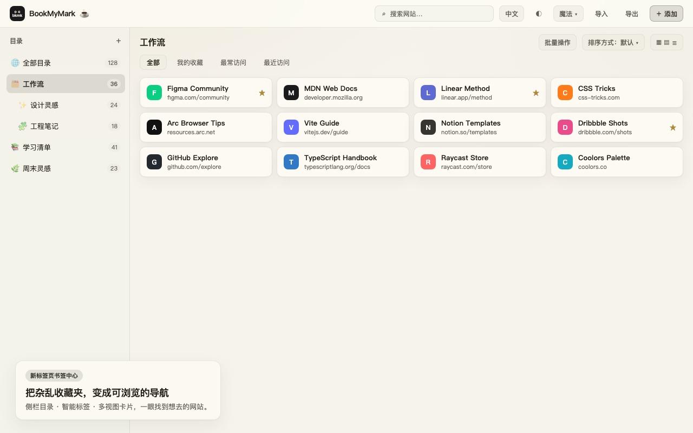
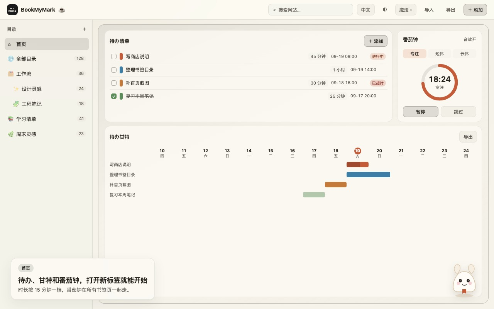
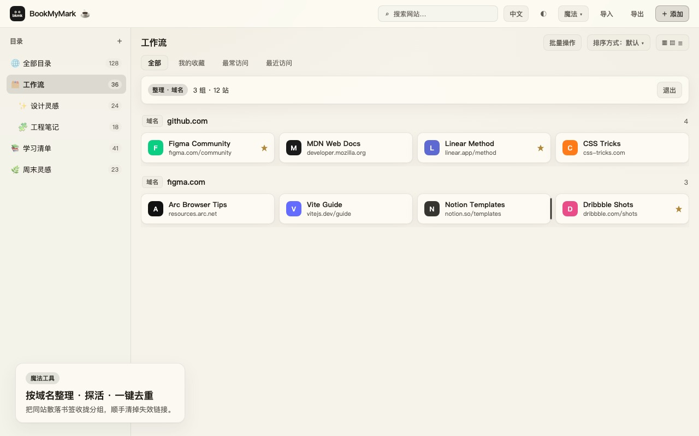
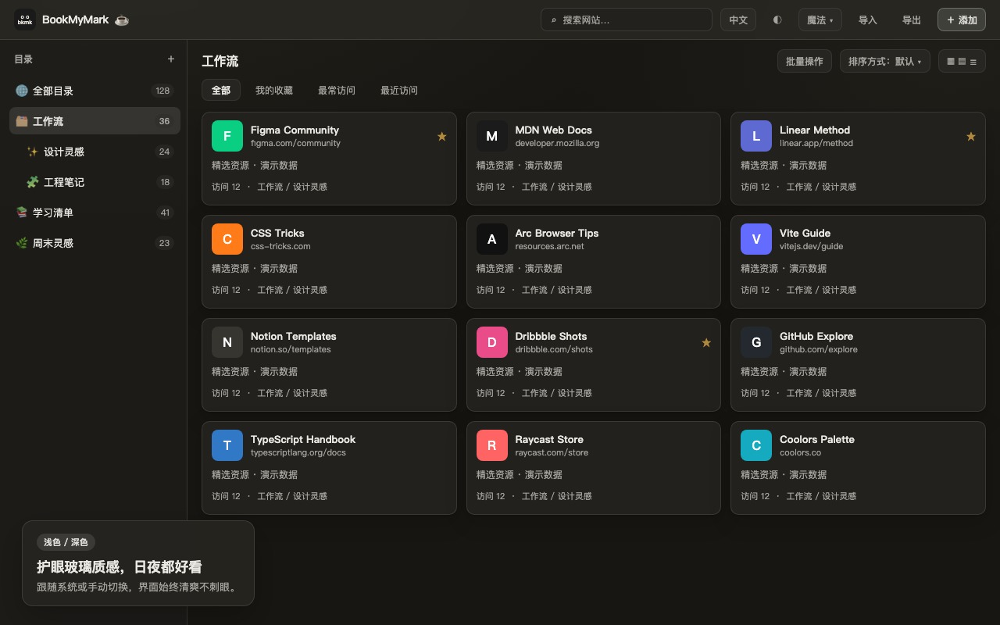

<p align="center">
  
</p>

<h1 align="center">BookMyMark</h1>

<p align="center">
  精致的 Chrome 新标签页书签管理器
</p>

<p align="center">
  <a href="README.md">English</a> ·
  <a href="LICENSE">MIT</a>
</p>

<p align="center">
  
</p>

把杂乱的书签栏，变成一页好看、好找、还能顺手专注的新标签页。

BookMyMark 用目录树管理收藏，支持即时搜索、按域名魔法整理、失效链接探活；首页还有待办、甘特排期和跨标签同步的番茄钟。数据都在本机，扩展不收集你的浏览内容。

## 特色

| | |
|---|---|
| **导航式书签** | 侧栏目录、收藏 / 最常 / 最近标签、卡片多视图，打开新标签就能浏览。 |
| **首页工作台** | 待办清单 + 待办甘特 + 番茄钟；时长按 15 分钟一档，番茄钟在多个书签页同步走表。 |
| **魔法整理** | 按域名收拢散落书签、一键去重，再配合 DNS 探活找出失效站点。 |
| **本地工具箱** | JSON 格式化 / 嵌套转义解析 / 树形查看，以及 URL 编解码；历史只存本机。 |
| **观感与语言** | 浅色 / 深色 / 跟随系统，多套配色；中 / EN / 日 / 韩 / 俄 / 法 / 印地语。 |
| **隐私优先** | 书签走 Chrome API，待办与设置存在 `chrome.storage.local`；探活与公网 IP 只请求必要的公开接口。 |

## 截图

<p align="center">
  
  
</p>
<p align="center">
  
  
</p>

## 安装

**从源码加载（开发 / 自用）**

```sh
pnpm install
pnpm build
```

1. 打开 `chrome://extensions` → 开启开发者模式
2. 「加载已解压的扩展程序」→ 选择 `.output/chrome-mv3`
3. 打开新标签页即可使用

开发热更新：

```sh
pnpm install
pnpm dev
```

保持 `pnpm dev` 运行，加载 `.output/chrome-mv3-dev`。关掉开发服务器后，开发版新标签页会白屏。

商店安装包：

```sh
pnpm zip
```

产物：`.output/bookmymark-*-chrome.zip`

## 技术栈

[WXT](https://wxt.dev) · Vue 3 · Tailwind CSS 4 · TypeScript · Chrome MV3

## 许可

[MIT](./LICENSE)
