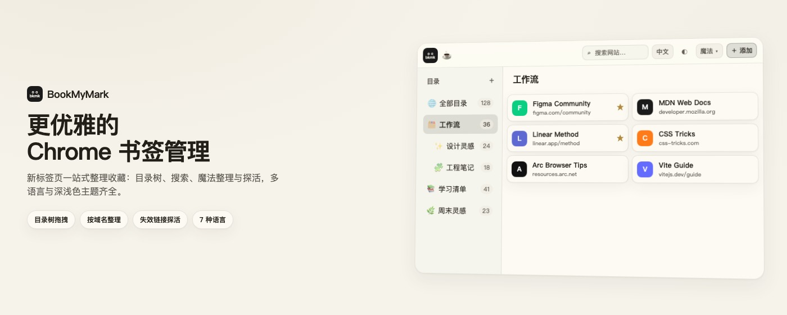
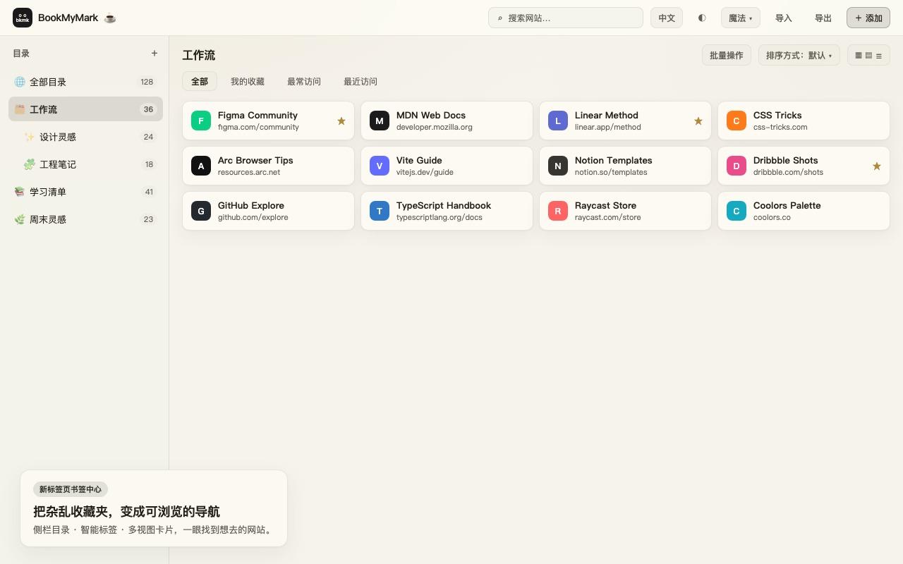
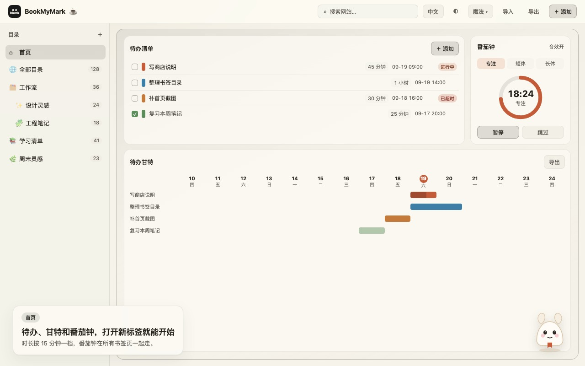
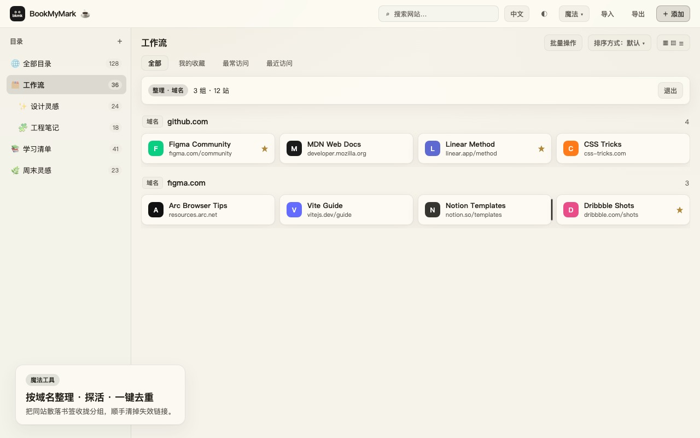
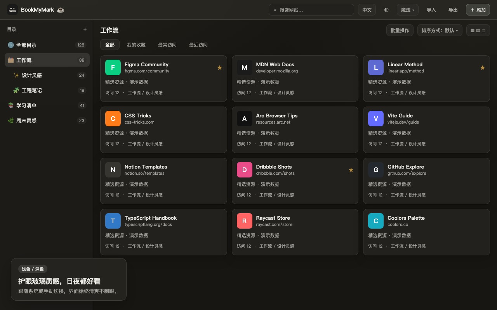

<p align="center">
  
</p>

<h1 align="center">BookMyMark</h1>

<p align="center">
  A polished Chrome new-tab bookmark manager
</p>

<p align="center">
  <a href="README-ZH.md">中文说明</a> ·
  <a href="LICENSE">MIT</a>
</p>

<p align="center">
  
</p>

Turn a messy bookmarks bar into a calm, searchable new-tab workspace—with focus tools when you need them.

BookMyMark replaces the new tab with a navigation-style bookmark home: folder tree, instant search, domain arrange, and dead-link probing. The Home board adds todos, a schedule Gantt, and a pomodoro clock that stays in sync across bookmark tabs. Everything stays on your device—the extension does not collect your browsing data.

## Highlights

| | |
|---|---|
| **Bookmark navigation** | Sidebar folders, Favorites / Most / Recent tags, and multi-view cards—browse the moment you open a new tab. |
| **Home workspace** | Todos + Gantt + pomodoro. Durations snap to 15-minute steps; the timer stays aligned across tabs. |
| **Magic arrange** | Group scattered bookmarks by domain, dedupe, then DNS-probe for dead sites. |
| **Local toolbox** | JSON format / nested-unescape / tree view, plus URL encode & decode. History stays in local storage only. |
| **Look & language** | Light / dark / system themes, accent colors, and 7 UI languages (zh / en / ja / ko / ru / fr / hi). |
| **Privacy first** | Bookmarks via Chrome APIs; todos and settings in `chrome.storage.local`. Probe and public-IP features call only the endpoints they need. |

## Screenshots

<p align="center">
  
  
</p>
<p align="center">
  
  
</p>

## Install

**Load from source**

```sh
pnpm install
pnpm build
```

1. Open `chrome://extensions` → enable Developer mode
2. “Load unpacked” → select `.output/chrome-mv3`
3. Open a new tab

Dev with HMR:

```sh
pnpm install
pnpm dev
```

Keep `pnpm dev` running and load `.output/chrome-mv3-dev`. If you stop the server, the dev new-tab page goes blank.

Chrome Web Store zip:

```sh
pnpm zip
```

Output: `.output/bookmymark-*-chrome.zip`

## Stack

[WXT](https://wxt.dev) · Vue 3 · Tailwind CSS 4 · TypeScript · Chrome MV3

## License

[MIT](./LICENSE)
